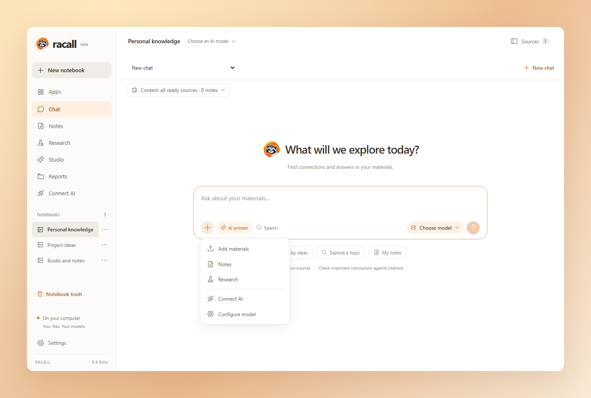
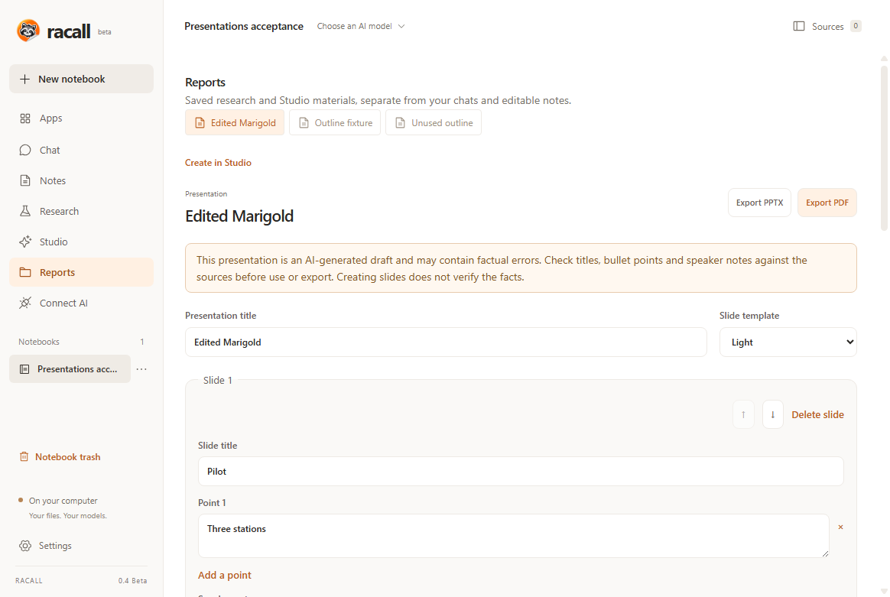
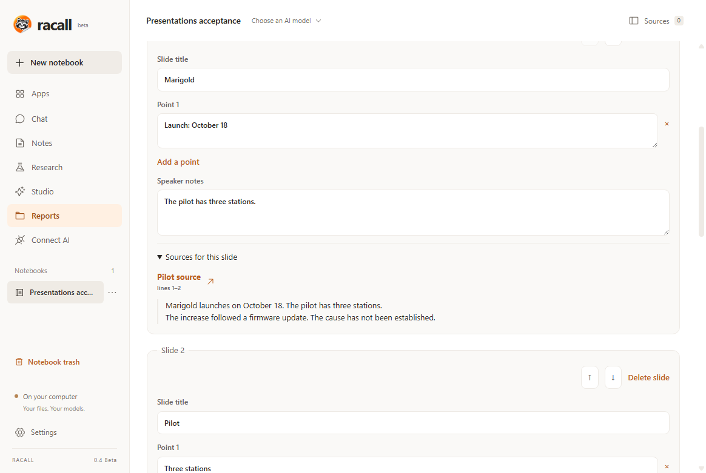

<p align="center">
  
  <picture>
    <source media="(prefers-color-scheme: dark)" srcset="assets/brand/wordmark-dark.svg" />
    
  </picture>
</p>

---

<h3 align="center">Racall is an open-source desktop alternative to NotebookLM + Obsidian.</h3>
<p align="center">
  <a href="#features">Features</a> •
  <a href="#-get-started">Quickstart</a> •
  <a href="docs/PRESENTATIONS.md">Presentations</a> •
  <a href="docs/README.md">Documentation</a>
</p>
<p align="center"></p>

## ⚡ Get started

**Racall 0.4 Beta is available for Windows, macOS and Linux.** Keep your sources, cited conversations and connected notes together — now with editable presentations.

| Platform                        | Link                                                                                                                                                                                                                                                           |
| :------------------------------ | :------------------------------------------------------------------------------------------------------------------------------------------------------------------------------------------------------------------------------------------------------------- |
| **Windows x64**                 | [EXE installer](https://github.com/woundscode/Racall/releases/download/v0.4.0-beta.1/Racall-0.4.0-beta.1-win-x64.exe)                                                                                                                                          |
| **Windows ARM64**               | [EXE installer](https://github.com/woundscode/Racall/releases/download/v0.4.0-beta.1/Racall-0.4.0-beta.1-win-arm64.exe)                                                                                                                                        |
| **macOS Apple Silicon (ARM64)** | [DMG](https://github.com/woundscode/Racall/releases/download/v0.4.0-beta.1/Racall-0.4.0-beta.1-mac-arm64.dmg) · [ZIP](https://github.com/woundscode/Racall/releases/download/v0.4.0-beta.1/Racall-0.4.0-beta.1-mac-arm64.zip)                                  |
| **macOS Intel x64**             | [DMG](https://github.com/woundscode/Racall/releases/download/v0.4.0-beta.1/Racall-0.4.0-beta.1-mac-x64.dmg) · [ZIP](https://github.com/woundscode/Racall/releases/download/v0.4.0-beta.1/Racall-0.4.0-beta.1-mac-x64.zip)                                      |
| **Linux x64**                   | [AppImage](https://github.com/woundscode/Racall/releases/download/v0.4.0-beta.1/Racall-0.4.0-beta.1-linux-x86_64.AppImage) · [Debian/Ubuntu package](https://github.com/woundscode/Racall/releases/download/v0.4.0-beta.1/Racall-0.4.0-beta.1-linux-amd64.deb) |
| **Linux ARM64**                 | [AppImage](https://github.com/woundscode/Racall/releases/download/v0.4.0-beta.1/Racall-0.4.0-beta.1-linux-arm64.AppImage) · [Debian/Ubuntu package](https://github.com/woundscode/Racall/releases/download/v0.4.0-beta.1/Racall-0.4.0-beta.1-linux-arm64.deb)  |

[Release notes](https://github.com/woundscode/Racall/releases/tag/v0.4.0-beta.1) · [SHA-256 checksums](https://github.com/woundscode/Racall/releases/download/v0.4.0-beta.1/SHA256SUMS.txt) · [Russian documentation](README.ru.md)

Packages include their runtime: no Python, Node.js or Docker installation is required. Windows and macOS packages are unsigned; macOS packages are not notarized. See the [installation notes](docs/releases/0.4.0-beta.1.md) for platform details.

Upgrading from 0.3? Close Racall and back up your knowledge folder first. The published Windows x64 installer passed the 0.3 → 0.4 upgrade check and preserved all 21 original test files, including after uninstall. This does not establish every upgrade path on other platforms. [Data and backup guide →](docs/GETTING_STARTED.md#data-and-backups)

1. Open Racall and create a notebook.
2. Open **Sources** and import a document.
3. Use **Search** immediately, or connect your model in **Settings** and choose sources or notes for a conversation.
4. Open a citation to inspect its passage, then capture your ideas in **Notes**.
5. Use **Research** or **Studio** to create a report, summary, study guide, review questions or presentation. Review the sources, save your edits, and export the result.

English is the default interface language. Switch to Russian in **Settings → Interface language**. The compact Windows installer also offers a language choice and applies it on first launch. Later updates keep your saved preference.

## New in 0.4 Beta

<p align="center"></p>
<p align="center"><em>Presentation editing and exports in Racall 0.4 Beta, with sample content.</em></p>

<details>
<summary>See the sources beside a slide</summary>

<p align="center"></p>

Read the saved passage, open its source, and check whether it still supports your edits. The screenshot uses sample content.

</details>

- **Turn sources into slides.** Generate a saved outline from selected sources and notes in Studio, then edit titles, bullet points and speaker notes.
- **Review the evidence.** Open complete saved passages beside each slide. Changed wording keeps its original references visible for rechecking.
- **Keep your edits.** Reorder or delete slides, choose Light/Dark templates, and recover unsaved drafts after restarting.
- **Export what you approved.** Python assembles the saved outline without another AI rewrite. Export editable PPTX or PDF, with speaker notes and source quotations; no Office installation is required.
- **Preserve source context.** Whole paragraphs and Markdown fences retain their conditions. Missing or oversized context produces an explicit message, and omitted material stays visible as partial coverage.

**AI-generated slides are drafts.** The evidence critic can accept unsupported claims. Check titles, bullets and speaker notes against their sources before sharing; creating slides does not verify the facts.

[Presentation guide](docs/PRESENTATIONS.md) · [0.4 release notes](docs/releases/0.4.0-beta.1.md) · [Full changelog](CHANGELOG.md)

## Features

| Bring your sources                                             | Build your knowledge                                                 |
| :------------------------------------------------------------- | :------------------------------------------------------------------- |
| Import text PDFs, Markdown, TXT and DOCX                       | Write portable Markdown with frontmatter and wikilinks               |
| Save public HTML pages by URL                                  | Ask follow-up questions over selected sources and notes              |
| Search locally, with optional embeddings                       | Inspect exact passages, historical citations and PDF page references |
| Keep originals and source versions on your computer            | Create cited reports, study materials and editable presentations     |
| Replace files or refresh websites without losing old citations | Export Markdown, PPTX or PDF; turn text materials into notes         |

- **Your choice of AI.** Use OpenAI, Claude, Ollama Local/Cloud, llama.cpp or a custom OpenAI-compatible connection. Models need complete structured JSON output; model quality varies.
- **Local files you own.** Notes and originals remain on disk. Open a notebook folder as an Obsidian vault, or use another Markdown editor.
- **Evidence you can inspect.** Answers undergo citation validation and a separate model critique. AI review can still miss mistakes: follow the citations.
- **Connect your tools.** A read-only MCP server exposes one selected notebook to compatible desktop clients.
- **A desktop that fits.** Light, Dark and System themes, English/Russian controls and a searchable model picker. Apps copies launch commands for external tools such as Claude Code and Codex CLI; you run them in your terminal.
- **Useful without a model.** Import, browse, write notes and run text search without API access.

The screenshots show the actual Racall 0.4 Beta interface with sample content. The hero's orange backdrop is presentation artwork; window controls follow your operating system.

## Your model, your data

In **Settings → AI connection**, save your provider, API URL, key and model. Profiles stay separate when switching providers. Use the model picker beside the message box to browse a saved connection. Local Ollama model downloads require explicit confirmation; opening or selecting a model starts neither a download nor a question. Embeddings are optional and configured separately. [Provider setup →](docs/PROVIDERS.md)

API keys use the operating system keychain. With a cloud provider, questions and retrieved passages are sent to that provider; cloud embeddings send the extracted document text. Local storage does not mean cloud inference stays on your machine.

Back up your knowledge folder with Racall closed. The exact location is shown in Settings; the legacy folder name `OpenNotebook` is kept for compatibility. [Data and backup guide →](docs/GETTING_STARTED.md#data-and-backups)

## What to expect from the beta

0.4 adds editable presentations to the existing notebook, chat and research workflows. Closing the app interrupts active generation; you choose whether to retry after restarting. Scanned PDFs need OCR elsewhere. Sync, mobile apps, graph view, generated audio/video and remote MCP/OAuth remain on the roadmap.

AI can produce unsupported claims even with correct citation text. The preserved presentation audit falsely accepted three of 11 invalid claims; the full set contained 34 claims. Those failures remain an open limitation, not a passed quality check. The bounded Ollama workflow covers one local Windows/model configuration. [Model-review record →](docs/MODEL_REVIEW_04_DISPOSITION_2026-11-03.md)

The released source passed **722 Python tests on each of six native targets**, packaged application and installer checks. All public package hashes were verified, and the published Windows x64 installer passed a separate 0.3 → 0.4 upgrade check. This does not cover every device or OS version. Linux AppImage checks use extracted contents rather than FUSE mounting. Microsoft PowerPoint itself was not tested; PPTX fonts may be substituted. [Verification scope →](docs/VERIFICATION_04_RELEASE_2026-11-04.md)

## Built with

| Language               | Responsibility                                                                                                                              |
| :--------------------- | :------------------------------------------------------------------------------------------------------------------------------------------ |
| **Python**             | Knowledge service, ingestion, retrieval, citations, research, presentation generation/rendering/exports, Studio jobs, MCP and backend tests |
| **TypeScript**         | React interface, typed API client and localization                                                                                          |
| **JavaScript**         | Electron desktop integration and UI smoke tests                                                                                             |
| **CSS**                | Interface layout and styling                                                                                                                |
| **PowerShell / Shell** | Developer setup on Windows and macOS/Linux                                                                                                  |
| **NSIS**               | Windows installation and language handoff                                                                                                   |

The GitHub Languages bar reflects source bytes, so its proportions change as the project grows. Generated bundles, dependencies and installers are not source files and are excluded from the repository.

## Development

Install Node.js 24, Python 3.12 and uv, then:

```sh
npm ci
uv sync --frozen
npm run dev
```

Developer setup helpers: `./scripts/setup.sh` on macOS/Linux, or `./scripts/setup.ps1` in PowerShell. They install this checkout's locked dependencies; they do not install system tools.

```sh
npm test -- -q
npm run lint
npm run format:check
npm run test:i18n
npm run check:release
npm run build
npm run typecheck
npm run test:desktop
npm run dist
```

Python binaries are built on each target OS and architecture. [Contributing](CONTRIBUTING.md) · [Release process](docs/RELEASING.md) · [Architecture decisions](docs/adr)

The project is developed with assistance from OpenAI Codex. Start with the
[development tour](docs/DEVELOPMENT.md), [architecture](docs/ARCHITECTURE.md) and
[code map](docs/CODE_MAP.md) for the files behind each feature. `npm run format`
applies the project's Python and interface formatting rules.

## Follow the project

Everything lives on GitHub for now: [downloads](https://github.com/woundscode/Racall/releases), [documentation](docs/README.md), [bugs and ideas](https://github.com/woundscode/Racall/issues), and [the roadmap](docs/ROADMAP.md). Read [CHANGELOG.md](CHANGELOG.md) for each release. Trying the beta, reporting a reproducible bug, improving translations or helping with macOS/Linux testing are all useful contributions.

## License

Python core and tools: [Apache 2.0](LICENSE). Interface and desktop application: [AGPLv3](COPYING). Both allow commercial use and sale subject to their terms. [Component boundaries and contributor rights](LICENSING.md).

The already-published **0.1 Beta** source and downloads remain under their original MIT terms. The component licenses above apply to the current release as described in [LICENSING.md](LICENSING.md); earlier grants are preserved.

Racall is independently developed and is not affiliated with NotebookLM, Obsidian or Unsloth.
