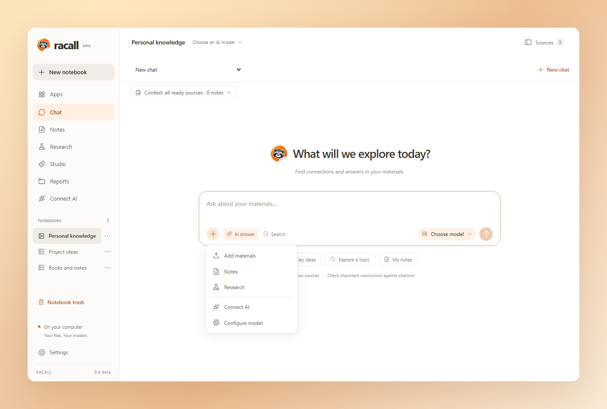
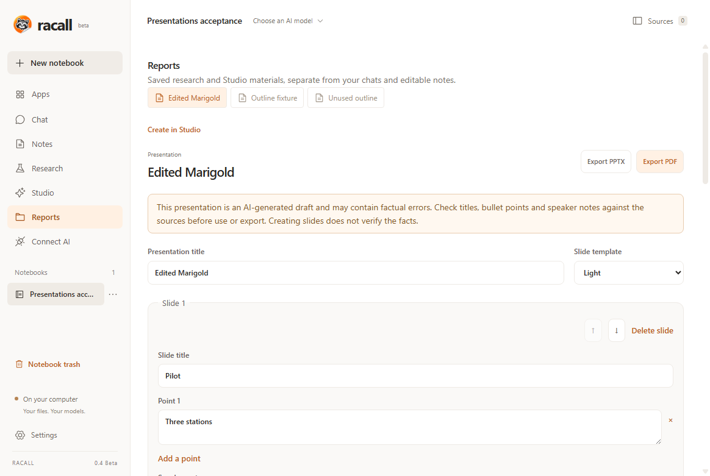
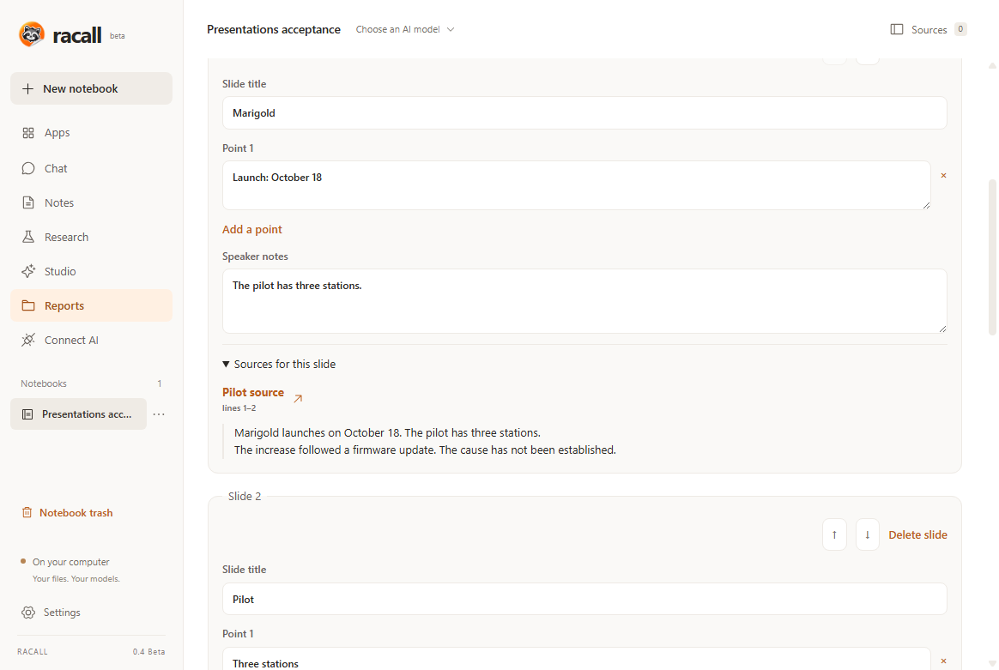

<p align="center">
  
  <picture>
    <source media="(prefers-color-scheme: dark)" srcset="assets/brand/wordmark-dark.svg" />
    
  </picture>
</p>

---

<h3 align="center">Racall — открытая настольная альтернатива NotebookLM + Obsidian.</h3>
<p align="center">
  <a href="#что-работает">Возможности</a> •
  <a href="#-установка">Быстрый старт</a> •
  <a href="docs/PRESENTATIONS.md">Презентации</a> •
  <a href="docs/README.md">Документация</a>
</p>
<p align="center"></p>

## ⚡ Установка

**Racall 0.4 Beta доступен для Windows, macOS и Linux.** Источники, диалоги с цитатами и связанные заметки — теперь ещё и с редактируемыми презентациями. [English documentation](README.md).

| Платформа                       | Ссылка                                                                                                                                                                                                                                                       |
| :------------------------------ | :----------------------------------------------------------------------------------------------------------------------------------------------------------------------------------------------------------------------------------------------------------- |
| **Windows x64**                 | [Установщик EXE](https://github.com/woundscode/Racall/releases/download/v0.4.0-beta.1/Racall-0.4.0-beta.1-win-x64.exe)                                                                                                                                       |
| **Windows ARM64**               | [Установщик EXE](https://github.com/woundscode/Racall/releases/download/v0.4.0-beta.1/Racall-0.4.0-beta.1-win-arm64.exe)                                                                                                                                     |
| **macOS Apple Silicon (ARM64)** | [DMG](https://github.com/woundscode/Racall/releases/download/v0.4.0-beta.1/Racall-0.4.0-beta.1-mac-arm64.dmg) · [ZIP](https://github.com/woundscode/Racall/releases/download/v0.4.0-beta.1/Racall-0.4.0-beta.1-mac-arm64.zip)                                |
| **macOS Intel x64**             | [DMG](https://github.com/woundscode/Racall/releases/download/v0.4.0-beta.1/Racall-0.4.0-beta.1-mac-x64.dmg) · [ZIP](https://github.com/woundscode/Racall/releases/download/v0.4.0-beta.1/Racall-0.4.0-beta.1-mac-x64.zip)                                    |
| **Linux x64**                   | [AppImage](https://github.com/woundscode/Racall/releases/download/v0.4.0-beta.1/Racall-0.4.0-beta.1-linux-x86_64.AppImage) · [Пакет Debian/Ubuntu](https://github.com/woundscode/Racall/releases/download/v0.4.0-beta.1/Racall-0.4.0-beta.1-linux-amd64.deb) |
| **Linux ARM64**                 | [AppImage](https://github.com/woundscode/Racall/releases/download/v0.4.0-beta.1/Racall-0.4.0-beta.1-linux-arm64.AppImage) · [Пакет Debian/Ubuntu](https://github.com/woundscode/Racall/releases/download/v0.4.0-beta.1/Racall-0.4.0-beta.1-linux-arm64.deb)  |

[Описание релиза](https://github.com/woundscode/Racall/releases/tag/v0.4.0-beta.1) · [Контрольные суммы SHA-256](https://github.com/woundscode/Racall/releases/download/v0.4.0-beta.1/SHA256SUMS.txt)

Пакеты включают необходимые компоненты: пользователю не нужны Python, Node.js или Docker. Пакеты Windows и macOS не подписаны; macOS-пакеты также не прошли notarization. Подробности — в [примечаниях к установке](docs/releases/0.4.0-beta.1.md).

Обновляетесь с 0.3? Сначала закройте Racall и сделайте резервную копию папки знаний. Опубликованный установщик Windows x64 прошёл проверку обновления 0.3 → 0.4 и сохранил все 21 исходный тестовый файл, в том числе после удаления приложения. Это не подтверждает все варианты обновления на других платформах. [Данные и резервные копии →](docs/GETTING_STARTED.md#data-and-backups)

1. Откройте Racall и создайте блокнот.
2. Откройте **Источники** и импортируйте документ.
3. Пользуйтесь **Поиском** сразу или подключите модель в **Настройках** и выберите источники или заметки для диалога.
4. Откройте цитату, чтобы проверить исходный фрагмент, и запишите свои идеи в **Заметках**.
5. В **Исследованиях** или **Студии** создайте отчёт, краткое содержание, учебный конспект, контрольные вопросы или презентацию. Проверьте источники, сохраните правки и экспортируйте результат.

По умолчанию интерфейс использует английский язык. Русский включается в **Settings → Interface language** / **Настройки → Язык интерфейса**. Компактный Windows-установщик также предлагает выбор языка для первого запуска. Обновление сохраняет уже выбранный язык.

## Новое в 0.4 Beta

<p align="center"></p>
<p align="center"><em>Редактирование и экспорт презентаций в Racall 0.4 Beta, пример содержимого.</em></p>

<details>
<summary>Посмотреть источники рядом со слайдом</summary>

<p align="center"></p>

Прочитайте сохранённый фрагмент, откройте источник и проверьте, подтверждает ли он изменённый текст. На скриншоте использован пример содержимого.

</details>

- **От источников к слайдам.** Создайте в Студии сохраняемый план по выбранным документам и заметкам, затем отредактируйте заголовки, тезисы и заметки докладчика.
- **Источники рядом.** Читайте полные сохранённые фрагменты возле каждого слайда. После изменения текста исходные ссылки остаются доступны для повторной проверки.
- **Правки не теряются.** Меняйте порядок слайдов, удаляйте лишние, выбирайте светлый или тёмный шаблон и восстанавливайте несохранённый черновик после перезапуска.
- **Экспорт утверждённого текста.** Python собирает слайды из сохранённого плана без нового AI-пересказа. Экспортируйте редактируемый PPTX или PDF с заметками докладчика и цитатами; установка Office не требуется.
- **Целые фрагменты контекста.** Абзацы и блоки Markdown сохраняют свои условия и оговорки. Отсутствующий или слишком большой контекст вызывает понятное сообщение, а неполное покрытие не скрывается.

**AI-презентация остаётся черновиком.** Модель-критик может принять неподтверждённое утверждение. Перед отправкой сверьте заголовки, тезисы и заметки докладчика с источниками: оформление слайдов не проверяет факты.

[Руководство по презентациям](docs/PRESENTATIONS.md) · [Подробности релиза 0.4](docs/releases/0.4.0-beta.1.md) · [Все изменения](CHANGELOG.md)

## Что работает

| Ваши источники                                               | Ваши знания                                                           |
| :----------------------------------------------------------- | :-------------------------------------------------------------------- |
| Импорт PDF с текстовым слоем, Markdown, TXT и DOCX           | Переносимые Markdown-заметки с frontmatter и wikilinks                |
| Сохранение публичных HTML-страниц по URL                     | Уточняющие вопросы по выбранным источникам и заметкам                 |
| Локальный поиск и необязательные embeddings                  | Точные фрагменты, исторические цитаты и страницы PDF                  |
| Оригиналы и версии источников на вашем компьютере            | Отчёты, учебные материалы и редактируемые презентации с цитатами      |
| Замена файлов и обновление сайтов с сохранением старых цитат | Экспорт Markdown, PPTX или PDF; копии текстовых материалов в заметках |

- **Своя модель.** OpenAI, Claude, Ollama Local/Cloud, llama.cpp или собственное OpenAI-совместимое подключение. Нужна модель с полным структурированным JSON-ответом; качество зависит от модели.
- **Ваши файлы.** Заметки и оригиналы остаются на диске. Папку блокнота можно открыть как vault в Obsidian или редактировать Markdown другим приложением.
- **Проверяемые свидетельства.** Ответы проходят проверку цитат и отдельную критику моделью. Такая проверка тоже может ошибиться: сверяйтесь с источниками.
- **Подключение инструментов.** Read-only MCP-сервер предоставляет совместимому desktop-клиенту доступ к одному выбранному блокноту.
- **Удобный desktop.** Светлая, тёмная и системная темы, английский и русский языки, поиск моделей. Раздел «Приложения» копирует команды для внешних инструментов, включая Claude Code и Codex CLI; запускать их в терминале решаете вы.
- **Работа без модели.** Импортируйте документы, просматривайте источники, ведите заметки и пользуйтесь текстовым поиском без API.

На скриншотах — настоящий интерфейс Racall 0.4 Beta с примером содержимого. Оранжевый фон главной иллюстрации — оформление; оконные кнопки зависят от операционной системы.

## Модель и данные

В **Настройки → Подключение AI** сохраните провайдера, URL API, ключ и модель. У провайдеров отдельные профили. Список рядом со строкой вопроса позволяет искать модели сохранённого подключения. Скачивание локальной модели Ollama требует отдельного подтверждения: открытие списка или выбор модели не запускают скачивание и не отправляют вопрос. Embeddings настраиваются отдельно и необязательны. [Настройка провайдеров →](docs/PROVIDERS.ru.md)

API-ключи хранятся в системном keychain. При использовании облачного провайдера ему отправляются вопросы и найденные фрагменты; при облачных embeddings — извлечённый текст документов. Локальное хранение файлов не означает, что облачная генерация выполняется на вашем компьютере.

Для резервной копии закройте Racall и скопируйте папку знаний. Точный путь показан в настройках; прежнее имя папки `OpenNotebook` сохранено для совместимости. [Данные и резервные копии →](docs/GETTING_STARTED.md#data-and-backups)

## Чего ожидать от беты

В 0.4 к блокнотам, чатам и исследованиям добавились редактируемые презентации. Закрытие приложения прерывает активную генерацию; после перезапуска вы сами решаете, повторять ли её. Сканированным PDF нужна внешняя обработка OCR. Синхронизация, мобильные приложения, граф, генерация аудио/видео и remote MCP/OAuth остаются в планах.

AI может добавить неподтверждённое утверждение даже при точных цитатах. В сохранённой проверке презентаций модель ошибочно приняла три из 11 неверных утверждений; полный набор содержал 34 утверждения. Эти ошибки остаются открытым ограничением. Проверенный сценарий Ollama охватывает одну локальную конфигурацию Windows и модели. [Результаты проверки модели →](docs/MODEL_REVIEW_04_DISPOSITION_2026-11-03.md)

Исходники релиза прошли **722 Python-теста на каждой из шести нативных платформ**, проверки упакованного приложения и установки. Контрольные суммы всех опубликованных пакетов сверены; опубликованный установщик Windows x64 отдельно прошёл проверку обновления 0.3 → 0.4. Это не проверка всех устройств и версий ОС. AppImage запускался из извлечённого содержимого, без FUSE-монтирования. Сам Microsoft PowerPoint не проверялся; в PPTX возможна подстановка шрифтов. [Объём проверок →](docs/VERIFICATION_04_RELEASE_2026-11-04.md)

## На чём построено

| Язык                   | Ответственность                                                                                                                  |
| :--------------------- | :------------------------------------------------------------------------------------------------------------------------------- |
| **Python**             | Сервис знаний, импорт, поиск, цитаты, исследования, генерация/отрисовка/экспорт презентаций, задания Студии, MCP и backend-тесты |
| **TypeScript**         | React-интерфейс, типизированный API-клиент и локализация                                                                         |
| **JavaScript**         | Интеграция Electron с системой и интерфейсные smoke-тесты                                                                        |
| **CSS**                | Вёрстка и оформление интерфейса                                                                                                  |
| **PowerShell / Shell** | Настройка окружения разработчика на Windows и macOS/Linux                                                                        |
| **NSIS**               | Установка Windows-приложения и передача выбранного языка                                                                         |

GitHub Languages показывает объём исходных файлов, поэтому пропорции меняются по мере развития проекта. Сгенерированные сборки, зависимости и установщики не являются исходным кодом и не включаются в репозиторий.

## Разработка

Установите Node.js 24, Python 3.12 и uv, затем:

```sh
npm ci
uv sync --frozen
npm run dev
```

Помощники настройки: `./scripts/setup.sh` на macOS/Linux или `./scripts/setup.ps1` в PowerShell. Они устанавливают зафиксированные зависимости проекта, но не системные инструменты.

```sh
npm test -- -q
npm run lint
npm run format:check
npm run test:i18n
npm run check:release
npm run build
npm run typecheck
npm run test:desktop
npm run dist
```

Python-бинарники собираются на каждой целевой ОС и архитектуре. [Участие в разработке](CONTRIBUTING.md) · [Процесс релизов](docs/RELEASING.md) · [Архитектурные решения](docs/adr)

Проект разрабатывается с помощью OpenAI Codex. Начните с [руководства разработчика](docs/DEVELOPMENT.md), [архитектуры](docs/ARCHITECTURE.md) и [карты кода](docs/CODE_MAP.md), чтобы найти нужную функцию. `npm run format` применяет правила форматирования Python и интерфейсного кода.

## Следить за проектом

Пока всё находится на GitHub: [загрузки](https://github.com/woundscode/Racall/releases), [документация](docs/README.md), [ошибки и идеи](https://github.com/woundscode/Racall/issues), [план развития](docs/ROADMAP.md). Изменения каждой версии собраны в [CHANGELOG.md](CHANGELOG.md). Будем рады отзывам о бете, воспроизводимым баг-репортам, переводам и помощи с проверкой macOS/Linux.

## Лицензии

Python-ядро и инструменты — [Apache 2.0](LICENSE). Интерфейс и desktop-приложение — [AGPLv3](COPYING). Обе лицензии разрешают коммерческое использование и продажу при соблюдении их условий. Распределение по папкам и правила участия описаны в [LICENSING.md](LICENSING.md).

Уже опубликованные установщики **0.1 Beta** и исходники этого тега сохраняют первоначальную MIT-лицензию. Компоненты текущего выпуска распространяются по указанным выше лицензиям с сохранением ранее выданных прав; подробности — в [LICENSING.md](LICENSING.md).

Racall — независимый проект, не связанный с NotebookLM, Obsidian или Unsloth.
