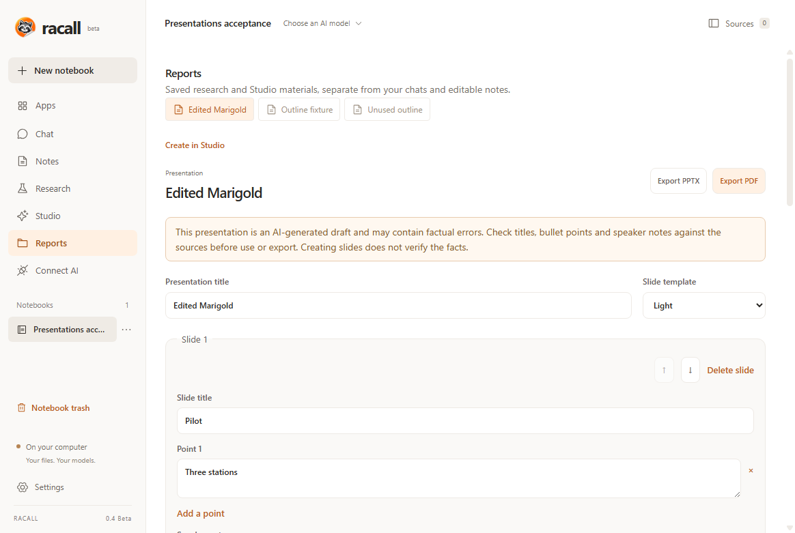

  
  <picture>
    <source media="(prefers-color-scheme: dark)" srcset="https://raw.githubusercontent.com/woundscode/Racall/v0.4.0-beta.1/assets/brand/wordmark-dark.svg" />
    
  </picture>

# Racall 0.4 Beta — editable presentations

Racall is an open-source desktop alternative to NotebookLM + Obsidian.
**0.4 brings editable presentations to your sources, cited conversations and connected notes.**

[What's new](#whats-new) · [Downloads](#downloads--upgrade) · [Known limits](#known-limits) · [Documentation](https://github.com/woundscode/Racall/blob/v0.4.0-beta.1/docs/README.md) · [Contribute](https://github.com/woundscode/Racall/blob/v0.4.0-beta.1/CONTRIBUTING.md)

**AI-generated slides are drafts.** The evidence critic can accept unsupported
claims. Review titles, bullets and speaker notes against their sources before
sharing. Model acceptance and user approval do not certify factual accuracy.

<em>Actual Racall 0.4 Beta interface with sample content.</em>

## What's new

- **Turn sources into slides.** Generate a saved outline in Studio from selected
  sources and notes. Edit slide titles, bullets and speaker notes, reorder or
  delete slides, and choose a Light or Dark presentation template.
- **Read the evidence beside each slide.** Open complete saved passages with
  their source locations. Edited content keeps the original AI references
  visible for rechecking.
- **Keep the text you approved.** Python assembles the saved outline without
  another AI rewrite, preserving its text, slide order, citations and edit states.
  Assembly and export work with the model disconnected.
- **Export editable PPTX or PDF.** Exports retain speaker notes and source
  quotations. The SVG preview and PDF embed Cyrillic fonts; creating files does
  not require an Office installation.
- **Recover your work.** Revision-aware saves preserve earlier versions,
  unfinished drafts survive restart, and stale saves cannot replace newer edits.
  The controls support English and Russian.

[Read the presentation guide →](https://github.com/woundscode/Racall/blob/v0.4.0-beta.1/docs/PRESENTATIONS.md)

## Fixes and improvements

- Keep complete saved source and Markdown note blocks in presentation context
  instead of cutting off a passage at the character budget. Disclose omitted
  material and report missing or wholly oversized context before generation.
- Preserve Markdown fences and correctly highlight source quotations when emoji
  appear before or within the cited text.
- Reuse one source-anchored fact ledger for titles, bullets and speaker notes,
  with a fallible evidence audit. Generated content remains unvalidated.
- Recover interrupted outlines, remove obsolete claims after slide deletion,
  and release completed job reservations atomically.
- Allow longer streamed protocol responses while preserving answer limits,
  deadlines, cancellation and completion checks.
- Include PPTX speaker-note templates in native packages. Update Electron to
  44.10.2, Next.js to 16.4.5, and apply scoped dependency security fixes.

Python owns source context, outline generation, slide assembly, saved revisions,
rendering and exports. The interface presents those operations.

## Downloads & upgrade

Choose the package matching your operating system and processor.

| Platform                        | Packages                                                                                                                                                                                                                                     |
| :------------------------------ | :------------------------------------------------------------------------------------------------------------------------------------------------------------------------------------------------------------------------------------------- |
| **Windows x64**                 | [EXE installer](https://github.com/woundscode/Racall/releases/download/v0.4.0-beta.1/Racall-0.4.0-beta.1-win-x64.exe)                                                                                                                        |
| **Windows ARM64**               | [EXE installer](https://github.com/woundscode/Racall/releases/download/v0.4.0-beta.1/Racall-0.4.0-beta.1-win-arm64.exe)                                                                                                                      |
| **macOS Apple Silicon (ARM64)** | [DMG](https://github.com/woundscode/Racall/releases/download/v0.4.0-beta.1/Racall-0.4.0-beta.1-mac-arm64.dmg) · [ZIP](https://github.com/woundscode/Racall/releases/download/v0.4.0-beta.1/Racall-0.4.0-beta.1-mac-arm64.zip)                |
| **macOS Intel x64**             | [DMG](https://github.com/woundscode/Racall/releases/download/v0.4.0-beta.1/Racall-0.4.0-beta.1-mac-x64.dmg) · [ZIP](https://github.com/woundscode/Racall/releases/download/v0.4.0-beta.1/Racall-0.4.0-beta.1-mac-x64.zip)                    |
| **Linux x64**                   | [AppImage](https://github.com/woundscode/Racall/releases/download/v0.4.0-beta.1/Racall-0.4.0-beta.1-linux-x86_64.AppImage) · [DEB](https://github.com/woundscode/Racall/releases/download/v0.4.0-beta.1/Racall-0.4.0-beta.1-linux-amd64.deb) |
| **Linux ARM64**                 | [AppImage](https://github.com/woundscode/Racall/releases/download/v0.4.0-beta.1/Racall-0.4.0-beta.1-linux-arm64.AppImage) · [DEB](https://github.com/woundscode/Racall/releases/download/v0.4.0-beta.1/Racall-0.4.0-beta.1-linux-arm64.deb)  |

[SHA-256 checksums](https://github.com/woundscode/Racall/releases/download/v0.4.0-beta.1/SHA256SUMS.txt) · [Russian documentation](https://github.com/woundscode/Racall/blob/v0.4.0-beta.1/README.ru.md)

Packages include their runtime; no Python, Node.js or Docker installation is
required. Run the Windows installer, copy the macOS application from the DMG
to Applications, or install the Linux DEB/use the AppImage. Choose English or
Russian in Settings; the Windows installer also offers a language choice.

Connect your model in Settings to generate an outline. Saved slide assembly and
export work without a running model.

**Upgrading from 0.3? Close Racall and back up your knowledge folder first.**
Settings shows its location. Install the new version manually; there is no
automatic updater. The published Windows x64 installer passed the upgrade check and preserved all
21 original fixture files, including after uninstall. This checked path does
not establish every upgrade scenario on other platforms.
[Data and backups →](https://github.com/woundscode/Racall/blob/v0.4.0-beta.1/docs/GETTING_STARTED.md#data-and-backups)

## Verification

The fresh [tag build](https://github.com/woundscode/Racall/actions/runs/41890925811)
passed all six Windows/macOS/Linux x64 and ARM64 targets, with 722 Python tests
per target, packaged application and installer checks, and ten verified packages.
All eleven public assets, including checksums, match the build's sizes and hashes.
The published Windows x64 installer passed a separate
[0.3 → 0.4 upgrade check](https://github.com/woundscode/Racall/actions/runs/41895993036):
eight checks, all 21 original fixture files preserved and four screenshots
visually reviewed. Local desktop editing, export and persistence checks also passed.
[Published verification and exact scope →](https://github.com/woundscode/Racall/blob/main/docs/VERIFICATION_04_RELEASE_2026-11-04.md)

These synthetic checks establish application behavior, not model factual accuracy.

## Known limits

- **AI review is fallible.** The preserved 34-claim audit contains three falsely
  accepted unsupported claims. More memory helped model loading, but does not
  correct these full-context semantic errors. A stronger model may help without
  guaranteeing correctness.
  [Model-review record](https://github.com/woundscode/Racall/blob/v0.4.0-beta.1/docs/MODEL_REVIEW_04_DISPOSITION_2026-11-03.md).
- **Unsigned beta packages.** Windows/macOS packages are unsigned; macOS is not
  notarized. Native checks do not cover every physical device, OS version or
  Linux AppImage FUSE setup.
- **Office compatibility has limits.** Microsoft PowerPoint itself was not
  tested. PPTX does not embed its font, so another editor may substitute typography.
  PDF provides a fixed layout.
- **Limited live-model coverage.** A bounded Ollama workflow covered one local
  Windows/model configuration. Other models and providers may behave differently.
- **Focused presentation scope.** Images, generated audio/video, arbitrary slide
  imports and AI revision of individual slides are outside 0.4. Mobile and sync
  remain future work.

## Feedback and contributions

[Report a bug or suggest an improvement](https://github.com/woundscode/Racall/issues/new/choose)
with your OS/architecture, app version, model/provider and reproduction steps.
Code, documentation, translations and testing contributions are welcome:
[contributing guide](https://github.com/woundscode/Racall/blob/v0.4.0-beta.1/CONTRIBUTING.md).

[Full changelog](https://github.com/woundscode/Racall/blob/v0.4.0-beta.1/CHANGELOG.md) ·
[Licensing](https://github.com/woundscode/Racall/blob/v0.4.0-beta.1/LICENSING.md) ·
[Dependency assessment](https://github.com/woundscode/Racall/blob/v0.4.0-beta.1/docs/DEPENDENCY_REVIEW_04_2026-11-03.md)

Racall is independent of NotebookLM, Obsidian and Unsloth.
